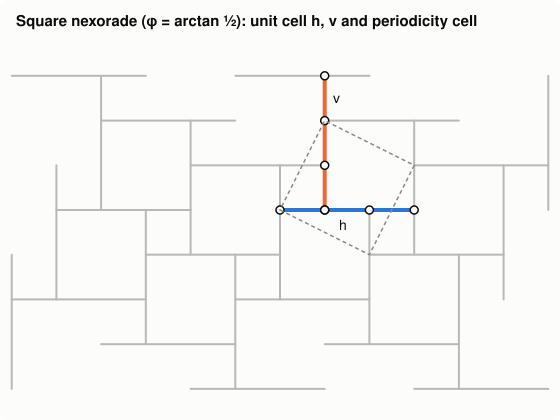
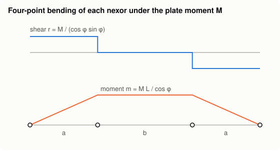
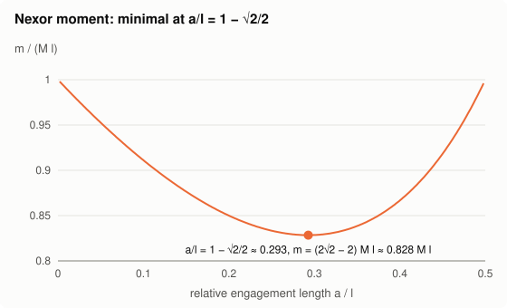
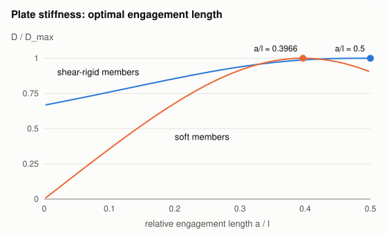

# Nexorade — a Lean formalization

Machine-checked formalization (Lean 4 + Mathlib, no axioms, no `sorry`) of

> L. Greco, A. Lebée, C. Douthe,
> **Investigation of the elastic behavior of reciprocal systems using homogenization techniques**,
> 2013.
> [ResearchGate](https://www.researchgate.net/publication/270451899_Investigation_of_the_elastic_behavior_of_reciprocal_systems_using_homogenization_techniques)

The paper homogenizes the square nexorade (reciprocal frame with spherical joints) as a
Kirchhoff–Love plate and finds a **degenerate** plate: only bi-axial bending stores energy. This
folder proves the paper's closed-form results from the statics of the two-beam unit cell. It builds
on the [`ContinuumMechanics`](../../ContinuumMechanics) library (Kirchhoff–Love plates and their Navier
solutions).

<p align="center">
  
  
</p>
<p align="center">
  
  
</p>

The figures are drawn by [`figures/generate.py`](figures/generate.py) from the formulas proved here:
the unit cell (§3.1), the only admissible field, four-point bending (§3.2), the maximal moment
(33), and the stiffness for shear-rigid and very soft members (§4.2).

## Correspondence with the paper

✅ proved as stated in the paper; ❌ the paper's statement is wrong, and the Lean result proves
the corrected one.

| Paper | Lean | Status |
|---|---|---|
| §2.2 Static homogenization: the plate energy is the minimum of the cell complementary energy (Hill–Mandel) | `Homogenized.lean`: `Cell.isLeast_outOfPlane` | proved for the nexorade |
| §3.1 Unit cell, `a = L sin φ`, `l = L (cos φ + sin φ)` (19) | `Parametric.lean`: `cellOf`, `area_cellOf`, `length_cellOf` | ✅ |
| §3.2 Only one admissible stress field: four-point bending | `OutOfPlane.lean`: `Cell.admissible_iff` | ✅ |
| (20) `M₁₂ = 0`, `M₁₁ = M₂₂` | `Cell.M11_eq_M22` (and `M₁₂ = 0` by construction) | ✅ |
| §3.3 Equivalent isotropic plate | `DegeneratePlate.toPlate`, `moment_eq_momentX` | ❌ the paper states `ν = −1`; the proof gives `ν = +1`: with `M = D((1−ν)K + ν tr K I)` only `ν = 1` gives `M₁₁ = M₂₂`, `M₁₂ = 0` and the rank-1 energy `½ D (tr K)²` |
| (22) Shear `r = M / (cos φ sin φ)` | `shear_cellOf` (`= 2M / sin 2φ`) | ✅ |
| (23) Moment `m = M L / cos φ` | `moment_cellOf` | ✅ |
| (24)–(27) Degenerate plate: `ΔM + p = 0`, energy only in the mean curvature, `K = d M` | `Plate.lean`: `legendre_le`, `legendre_eq`, `DegeneratePlate` | ✅ |
| (28)–(30) Compliance `d`, stiffness `D` with `η = GSₛa²/EI` | `Cell.compliance`, `Cell.energy_eq`, `Cell.stiffness_eq_eta`; in `(L, φ)`: `compliance_cellOf`, `stiffness_cellOf` | ✅ |
| (31) Euler–Bernoulli members (`GSₛ → ∞`) | `Optimum.lean`: `Cell.complianceEuler_inv`, `Cell.tendsto_compliance_shear_rigid` | ✅ |
| §4.1 `D → 0` as `a/l → 0` | `tendsto_stiffness_zero` | ✅ |
| (32) Shear and moment in terms of `a/l` | `Cell.shear_eq`, `Cell.moment_eq` | ✅ |
| (33) Moment minimal at `a/l = 1 − √2/2` (`φ = π/8`), `m_min = (2√2 − 2) m_max ≈ 0.828 m_max` | `momentShape_ge`, `momentShape_opt`, `momentShape_zero`, `momentShape_half` (also `normalized_moment_optimal` in `φ`) | ✅ |
| §4.2 Stiffness optimum: `a/l = 1/2` for shear-rigid members | `eulerShape_le` | ✅ |
| §4.2 Stiffness optimum for soft members: the root `x₀ ∈ (0.3966, 0.3967)` of `2x³ − 2x² + 3x − 1` | `Cell.tendsto_stiffness_soft`, `softShape_le`, `exists_unique_optPoly_root`, `optPoly_root_bounds` | ✅ |
| §4.2 Trade-off: +7% deflection (`5√2 − 6`) vs +20% stresses (`(√2 + 1)/2`) | `deflection_ratio`, `moment_ratio` | ✅ |
| §5.1 Navier solution (34)–(36) | `DegeneratePlate.navier`, `navier_kirchhoffLove` | ✅ |
| §5.2 Finite element comparison (ABAQUS) | — | out of scope (numerical) |
| Scale separation: convergence of the frame to the plate | `Frame.lean`: `existsUnique_bloch`, `tendsto_frame` | ✅ for the infinite nexorade under a load `p₀ e^{ik·x}`: as `k → 0` the joint deflections over the plate deflection `p₀ d e^{ik·x}/\|k\|⁴` tend to 1, and `\|k\|²` × the member forces tend to the four-point bending of (22); general frames and loads assumed (see *Assumptions* below) |
| Membrane behaviour (left to future work in the paper): `N₁₂ ≡ 0`, `A₂₂₁₁ = 0`, `A₁₁₁₁ = (1/A)(ab(2a+b)/(2GSₛ) + (4a³+6a²b+5ab²+2b³)/(2ES) + a²b²(2a+b)/(12EI))` | `InPlane.lean`, `Cell.isLeast_inPlane` | ✅ (extension) |

## Assumptions

**Homogenization of periodic frames as plates.** For a periodic beam frame of cell size `ε → 0`
under slowly varying loads, the frame response converges to that of the Kirchhoff–Love plate whose
compliance is given by the static (Hill–Mandel) cell problem ([Caillerie1984], [LebeeSab2013]). The
paper uses this as its modelling hypothesis. `Frame.lean` proves it for the square nexorade under
single-mode loads `p₀ e^{ik·x}` (`Cell.tendsto_frame`); general frames, general loads and bounded
domains remain assumed. Proving them would need two-scale or Γ-convergence for discrete lattices
and Korn-type inequalities for frames.

* [Caillerie1984] D. Caillerie, *Thin elastic and periodic plates*, Math. Methods Appl. Sci. (1984).
* [LebeeSab2013] A. Lebée, K. Sab, *Homogenization of a space frame as a thick plate*, Computers
  and Structures (2013).

## Building

From the repository root, after `lake build`:

```sh
(cd papers && lake build Nexorade)
scripts/check_no_sorry_axiom.sh
```
